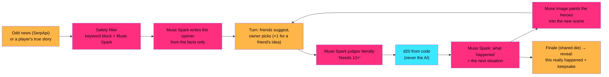

# PITCH CARD: Group Project

*A game night that gives everyone an excuse to talk to each other.*

Rewritten Sat Oct 24 ~9:30 PM for the current build (turn-based, Odd news / Our stories, heroes painted into each
scene, narrator, reveal + keepsake). Full audit: design/25-meta-alignment.md.

CD = creative director (talks, hosts). ENG = engineer (drives the laptop and hotkeys).
**Hand them the QR first, talk second. Never type for the judge.**

**Cut features. Never mention them:** secret clues, Convince the DM, Boost, Catch!, Mirror, Mirror, hearts / Hope.
If a judge asks about something we cut, say "we cut it after playtesting; it crowded the screen."

---

## The 30-second opener (connection first)

Say it to the judges, not the screen. About 75 words. Pause where marked.

> "Quick question. Last time you hung out with friends, how much of it was everyone on their own phone?
> *(beat, let them answer)*
> We built a game night that turns that around. Your phone is the controller, the TV is the table, and Muse is the
> Dungeon Master, so nobody has to prep. On your turn, your friends pitch you ideas. Use one and they get the credit
> on screen. And every story really happened, to the world or to one of you. Scan this, you're in."

Hand over the QR on "Scan this".

**Shorter (15 s, for a judge walking past):** "It's a party game where Muse is the Dungeon Master. On your turn your
friends pitch you ideas, and the story is something that really happened. Scan this and play one turn."

## 3 lines to remember

1. **"A game night that gives everyone an excuse to talk to each other."**
2. **"On your turn, your friends pitch you ideas. Use one and they get the credit."**
3. **"Every story really happened, to the world or to one of you."**

## Meta's rubric, and our one beat for each

| Criterion | Weight | Say it | Where they see it |
|---|---|---|---|
| Human connection | 30% | "Helping a friend is the best move in the game." | Friends' suggestions, "+ Sam's idea · +1", the shake-together finale, "Solved by" with their real knack |
| AI essential + integrated | 25% | "Muse writes the story, judges every move and paints your heroes into it." | The narrator, "Needs 12+", the new painting per decision, DM's Notes (N) |
| Originality | 20% | "It really happened, and you find out how it ended." | The reveal: the article or a friend's real ending, plus "what's happening now" |
| Working demo | 20% | "You just played it on your own phone." | Their own phone, real dice, nothing frozen |

## 4-minute table demo (Quick Tale)

Rehearse with a stopwatch. Quick Tale runs about 5 minutes on its own, so the talking happens **while** things load,
never on top of a judge's turn.

| Time | Who | Say / do |
|---|---|---|
| 0:00 | CD | **[CONNECTION]** The 30-second opener. Hand over the QR. ENG has the TV on the lobby with Quick Tale selected. |
| 0:30 | Judges | Scan, describe a hero in one line, answer "What are you weirdly good at?" CD: "No app, no account. Muse is painting you as a cartoon." If someone stalls, point at the ready-made heroes. |
| 0:55 | ENG | Starts the game. The real headline types onto the screen, then the title card. CD: "That's a real headline from the news. Harmless, just strange." |
| 1:10 | CD | **[AI]** While the narrator reads: "Muse wrote this opening from the article's facts, picked that narrator for the mood, and painted your heroes into the scene." |
| 1:30 | CD | **[CONNECTION]** First turn. "It's Sam's turn. Everyone else, send Sam an idea. Sam, pick one. If you use a friend's idea you get plus one, and their name goes on screen." **Then stop talking. Let them argue.** |
| 2:00 | CD | **[AI + DEMO]** "Muse judges the move exactly as written. It says what you need: 12 or higher. The dice are real random numbers, not the AI." Roll. |
| 2:15 | CD | Over the outcome: "Every decision gets a new painting with your heroes in it." Point at the crossfade. Next turns play; CD stays quiet. |
| 3:05 | CD | **[CONNECTION]** Finale: "Last move. Everyone votes, not for your own. Then everyone shakes their phone at the same time. One die for the whole table." |
| 3:25 | CD | **[ORIGINALITY]** Reveal. "This really happened." Let them read. Point at the "Solved by" line: "That's the thing you said you're weirdly good at." Keepsake QR: "Take the story home." |
| 3:45 | CD | **Scorecard close, one breath each:** "**Connection:** your friends' ideas are your best move. **AI:** Muse writes, judges, paints and narrates; code rolls the dice. **Original:** it really happened, and you find out how. **Working:** you just played it." |

Optional if they ask or there's time: **Our stories** ("next time, everyone writes a small true story, you play one,
and the end shows how it really went for that person") and **the Muse connector** (ENG shows a pre-opened Muse chat:
"Start a quick game night for the judges" returns the table link and an invite; "Muse drafts, you send"). Never run
the connector live unless the new build is deployed and it worked in the last 30 minutes.

If you're past 3:30: ENG skips to the reveal. Always end on the reveal and the four scorecard lines.

## How it works (if asked)

*Say: "Muse writes and judges. Code rolls and counts. Players play." Full-screen version: `design/how-it-works.html`
(check it's current before showing it).*

**Guardrails:** dice are crypto RNG in code. Every hero gets the same stat budget in code. The AI judges actions,
never people. Tragedies, crime, politics and health stories are filtered out. Player text is treated as in-world
speech. Every AI call has a canned fallback, so the table never freezes. DM's Notes shows every call live.

## Judge Q&A, by criterion

### Human connection (30%)
1. **Where's the human connection?** Every turn hands the table a reason to talk: your friends pitch you ideas and you
   pick one. Using a friend's idea is rewarded (+1, their name on screen). The finale is one die everyone shakes
   together. Your real "weirdly good at" answer shows up at the end in the "Solved by" line.
2. **What about "learning something about each other"?** Our stories: each player privately writes a small true story,
   the table plays one, and the end shows how it really went for that person. That came from Meta's own feedback
   on Saturday: "people can input their own stories."
3. **Isn't it just more screens?** The TV is the one shared screen. Phones are for typing and rolling. Typing is the
   default (voice is optional) so the room talks to each other, not at a microphone.
4. **Does one evening connect anyone?** We don't claim it does. It lowers the cost of starting a conversation, and the
   keepsake is how a night gets remembered.

### AI essential and well integrated (25%)
5. **How exactly do you use Muse?** Muse Spark: the news safety filter, the opening, every ruling, what happens next,
   the narrator casting, the ending. Muse Image: hero portraits and a new scene with your heroes per decision. Muse
   Voice Transcribe: optional voice input. And an MCP connector so Muse, the agent, can start a night. Take the AI
   away and there's no game.
6. **Why not just ChatGPT?** That's one person and a chatbot. This is a room: one shared screen, every phone a
   controller, friends feeding each other ideas, real dice, a reveal.
7. **Any non-Meta models?** One. Meta has no text-to-speech model, so the narrator is OpenAI gpt-4o-mini-tts, with
   Gemini TTS as the backup. We picked it by ear against the alternatives. Meta's team told us to choose the best
   model per job, and we tested each one (design/23).
8. **Can players break it?** The model returns strict JSON; code computes every number. Player text goes in as in-world
   speech. A plan like "ignore all previous instructions" just becomes something the hero shouts.
9. **What does the connector do?** An MCP endpoint at `/api/mcp` with `start_game_night`, `list_todays_tales` and
   `invite_message`. Muse can show tonight's odd news, open a table (quick or full) and draft the invite. It never sends.

### Originality (20%)
10. **What's new?** The story really happened: strange news from around the world this week, or a true story from
    someone at the table. You play it as a fantasy, then find out how it really ended.
11. **How do you keep tragic news out?** A keyword block, then a Muse Spark classifier. No deaths, injuries, crime,
    politics, health scares or mocking private people. The Kids / Teens / Adults setting narrows it further.
12. **Why cartoon heroes?** On purpose. It keeps it silly, protects privacy, and nobody is judged on their face.

### Working demo (20%)
13. **Is this real?** You just played it. Next.js on Vercel, Supabase Realtime, Muse from server routes, dice from code.
    If an AI call fails, a canned line fills in and the game keeps going.
14. **Where does SerpApi fit?** Google News via SerpApi finds the odd news. It's cached for 4 hours, so no game waits on it.
15. **What was hardest?** Making the writing easy to follow. Our first playtest produced "what the hell is foam?" We
    rewrote the prompts for an 8-year-old's reading level and cut most of our features down to one loop.
16. **How did you build it in a weekend?** Claude Code as lead engineer with parallel agents for research, building,
    review and QA; a 32-scenario DM stress test; a model bake-off with real calls (a better rubric took Spark from 5/8
    to 8/8 fair rulings); and agents analyzing our playtest recordings frame by frame.

(Novice judge? CD: "This is my first hackathon. The idea, the look, the narrator and every creative call are mine.")

## Research lines for connection (use 1, never all)

Keep the hedges exactly as written.
1. **The liking gap.** "After a conversation, people consistently underestimate how much the other person liked them
   (Boothby 2018, *Psychological Science*)."
2. **Talking to strangers.** "Commuters assigned to talk to a stranger enjoyed it more than they predicted (Epley and
   Schroeder 2014)." Say "in that study".
3. **Laughter bonds.** "Shared laughter is linked to endorphin release and group bonding (Dunbar 2012, *Proc. Royal Society B*)."
4. **AI that faces the group.** "A robot that made a small vulnerable remark got human teammates to talk more to each
   other, and more evenly (Traeger 2020, *PNAS*). Our AI talks to the table, not to you alone."

**Do not say:** "oxytocin builds trust", "studies show party games improve connection", "your AI friend", or that one
evening cures loneliness.

## Filler while things load

A ruling takes 1 to 2 s. A portrait and a scene painting take longer, but the game never waits: the old painting
stays up and the new one fades in. Past 6 s of quiet, CD talks: "The artist is still painting you in."

## If something breaks

- **A painting is slow:** say nothing; the old painting stays up and the new one crossfades in when ready.
- **Muse is slow or down:** canned lines fill in and the game keeps going. Keep talking.
- **The narrator is silent:** the text still appears. "Tonight the narrator is shy." Move on.
- **Live news is missing:** the vote uses our ready-made stories. Nobody can tell.
- **A phone won't join:** ENG joins from a second laptop tab, or hand them a spare phone.
- **Wi-Fi drops:** the table pauses itself. Switch to the phone hotspot. If that fails, play the backup video and talk over it.
- **Something offensive is typed:** the DM keeps it in-world. Smile and move on.
- **The connector fails:** skip it. Never imply it ran.
- **Past 4:00:** ENG skips to the reveal, then the scorecard.
