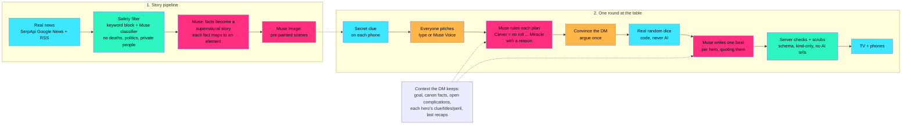

# PITCH CARD: Group Project

*The one group project everyone actually wants to be in.*

CD = Creative Director (talks, plays the host). ENG = Engineer (drives the laptop, hidden hotkeys).
Setup: laptop as TV, QR tent card, room pre-warmed in the lobby with "Who's playing?" set. Teammates join first and answer the two questions with fun, real answers, so judges see the tone. **Never type for the judge. Hand them the QR first, talk second.**

Items marked **(if shipped)** only get said if they are live in the build you are demoing. If not, skip the line, do not apologize, and do not describe it as working. "Real In, Magic Out" (the two questions, best-fit pick, spotlights, the solved-by line, the rating) is being built on `remote-play` (design/18): treat each as **(if shipped)** until you have seen it work in the demo build. Remote play, the refresh-proof host and Mirror, Mirror have been played end to end (with canned AI, not yet with live Muse).

## The hero moment
At the reveal: **"This really happened. Here's the article."** Then the line that names the crew: **"...solved by Ava's parallel parking and Ben's coffee." (if shipped)** Pause on it. It's the whole pitch in one line: the news gave the problem, your real selves were the solution. If the solved-by line didn't ship, the hero moment is "The official story" next to "What your group uncovered".

## Meta's rubric, and our one memorable beat for each

Meta judges score: **Human connection 30% · AI essential and integrated 25% · Originality 20% · Working demo 20%.** Top 3 teams get the Round 2 invite to Menlo Park, so the last 20 seconds of every pitch is a four-line scorecard.

| Criterion | Weight | Our beat (say it) | Where it lands in the demo |
|---|---|---|---|
| **Human connection** | 30% | **"A game night that gives everyone an excuse to talk to each other."** | Opening hook, playing yourself (two questions), the secret clues, Convince the DM, Catch!, Mirror, Mirror, the solved-by line |
| **AI essential + integrated** | 25% | **"Muse is the Dungeon Master, so nobody has to prep."** | Your real skill becoming a power, the best-fit story pick, the ruling, Convince the DM, portraits and scenes, hold-to-talk, the connector |
| **Originality** | 20% | **"The news gives the problem. Your real selves are the solution."** | The quest intro and the reveal: "This really happened", "solved by" your real skills |
| **Working demo** | 20% | **"Live on your phone, not a mockup."** | The judge scans, plays and rolls on their own device; real RNG; the fallback chain |

## 3 lines to remember
1. **"The one group project everyone actually wants to be in."**
2. **"A game night that gives everyone an excuse to talk to each other."**
3. **"Muse is the Dungeon Master. You just show up and talk."**

## The thesis (say it in your own words)
People avoid each other mostly out of uncertainty, not fear. We follow the crowd's silence. And we underestimate how much others enjoy us. Tabletop games fix this by giving everyone a role, a reason and a script. The only problem is that someone has to prep as Dungeon Master. Muse is the DM.

## How it works
*Full-screen version: `design/how-it-works.html`. Say: "Muse writes and judges. Code rolls and checks. Players play." If asked what the AI does behind the scenes, point at the DM's Notes, which shows every decision live.*

**Guardrails:** dice are real RNG. AI judges ideas, never people. No real people or brands. (If shipped:) every question is skippable, and your small fear is comedy for your character only: the game never asks you to actually do it. "Who's playing?" (Kids / Teens / Adults) sets which stories, DM tone and chat filtering apply; tragedy, victims, violence and politics are blocked at every rating. Player text is in-world speech (typed "ignore all previous instructions" and got "Pip shouts gibberish magic words at the sky."). Mirror sentences are kind-only. Fallbacks, so the table never freezes. DM's Notes shows every decision live.

## 4-minute table demo (built on the 30/25/20/20 rubric)

Tags in brackets show which criterion each beat is scoring. Demo quest: the 80-ton boulder that fell at a New Hampshire park (nobody hurt).

| Time | Who | Say / do |
|---|---|---|
| 0:00 | CD | **[CONNECTION]** "Quick question. Last time you were in a room full of people you kind of knew, who started the conversation? ...Right. Nobody. We're not scared of each other. We're just unsure, so we wait for someone else to talk. Tabletop games fix that, because everyone gets a role, a reason and a script. But someone has to prep as Dungeon Master. **So Muse is the DM.** Scan this, you're in." Hand over QR. |
| 0:20 | Judge | **[DEMO + CONNECTION]** Scans on their own phone. CD: "No app, no account. **You play yourself**, with a hidden magical side. Two quick questions, skip either." (if shipped) The judge answers: something they're weirdly good at, and a small thing that scares them. If not shipped: they type a one-line hero ("a retired knight afraid of geese"). |
| 0:35 | CD | **[AI]** "Muse Spark turns your real skill into a power, and your small fear into your character's flaw. That's comedy for your character only. Nobody has to actually do the scary thing. Muse Image is painting you as a cartoon, on purpose, so nobody has to be on camera." Portrait takes about 14 s. Keep talking until it appears. |
| 0:55 | ENG | **(if shipped)** Taps **"Pick the best story for us"**. CD: **[AI]** "Muse reads what you all just told it and picks the real story that fits this crew best, with one moment for each of you." If the pick isn't a pre-painted quest, ENG picks the boulder by hand (no comment). Otherwise ENG picks the boulder. Quest intro appears. |
| | CD | **[ORIGINALITY]** "Every quest is **real news from this week**, filtered for anything tragic or political, with one uncanny explanation added. An 80-ton boulder fell at a New Hampshire park and nobody got hurt. Tonight, we find out why." |
| 1:20 | CD | **[CONNECTION]** "Look at your phone. You each got a private clue the others don't have. Nobody can solve this alone, so you have to talk." (if shipped) "And this scene has a moment for someone's real skill. Whose is it?" Let the table talk for a few seconds. Do not rush it. |
| 1:40 | Judge | Makes a plan (speak it or type it). |
| | CD | **[AI]** "Muse rules on it..." (verdict lands: Clever, Solid, Risky, Absurd or Miracle) "A Clever plan works, no roll." If the ruling is harsh: "Now **Convince the DM**. You get one shot, by voice or text. A good argument can upgrade your plan to a sure thing." Judge argues. Verdict updates. |
| 2:10 | CD | **[CONNECTION]** "Everyone acts every round. No voting, so nobody's idea gets left out. See that 🔥? Boost a friend's plan and they roll better." Everyone rolls. "And if your friend fails, **Catch!** Spend your one heart to re-roll it." |
| 2:30 | CD | If a disaster happens: "Now you're stuck, and your friends have to rescue you next scene." Then: "Each hero gets one story beat, in your own words." Read one back to the table. |
| 2:45 | ENG | **[AI + DEMO]** **Muse connector beat (if shipped):** opens Muse, the personal agent, and types: "Start a game night for me and Mira." Muse calls our MCP endpoint (`start_game_night`, `list_todays_tales`, `invite_message`): a room appears on the TV and Muse drafts the invite. CD: "Muse doesn't just run the game. Muse can start the night." |
| 3:05 | ENG | Hotkey: skip to the Final Roll. CD: "Normally it's three scenes, then everyone makes their final move at once." |
| 3:12 | CD | **Mirror, Mirror:** "Each of you was secretly someone's guardian and wrote one kind sentence about their best moment. Guess what was written about you." ("Probably nothing.") TV reveals them. "Nobody ever rates anyone." Epilogue plays. |
| 3:22 | CD | **[ORIGINALITY + CONNECTION] The hero moment.** "**This really happened.** Here's the article." **"The official story"** (the real headline) next to **"What your group uncovered"**. Then read the line on the TV: **"Solved by Ava's parallel parking and Ben's coffee." (if shipped)** **Pause. Let them read and laugh.** |
| 3:40 | CD | Keepsake is saved to the shelf: "Next chapter, same crew." |
| 3:45 | CD | **Scorecard close (say all four, one breath each):** "**Connection:** you play yourselves, everyone gets a role, a reason and a script, and the night is saved for next chapter, same crew. **AI:** Muse is the DM, the painter, the ears, picks the story that fits you, and can start the night. **Original:** the news gives the problem, your real selves are the solution. **Working:** you just played it on your own phone." |

If the connector or the solved-by line did not ship, give their time back to Convince the DM and the reveal, and drop their words from the scorecard. Never drop the scorecard. **No TV at the table?** "Start a new game" on a phone makes it the host: every phone shows the story, with a crew chat for players who aren't in the same room.

## Research lines for "human connection" (30%)

Use 1 or 2 per pitch, never all of them. Keep the hedges exactly as written.

1. **The liking gap.** "After a conversation, people consistently underestimate how much the other person liked them (Boothby 2018, *Psychological Science*). That's why the quiet room stays quiet." *(Mirror, Mirror is built on this.)*
2. **Mistakenly seeking solitude.** "Commuters assigned to talk to a stranger enjoyed it more than they predicted (Epley and Schroeder 2014)." Say "in that study" and don't generalize.
3. **Laughter bonds.** "Shared laughter releases endorphins and bonds groups (Dunbar 2012, *Proc. Royal Society B*)."
4. **AI that faces the group.** "A robot that made a small vulnerable remark got human teammates to talk more to each other, and more evenly (Traeger 2020, *PNAS*). Our AI talks to the table, not to you alone."
5. **The problem.** "The US Surgeon General called loneliness an epidemic in 2023, and linked lacking social connection to mortality risk comparable to smoking up to 15 cigarettes a day." *(Keep the "up to".)*

**Do not say:** "oxytocin builds trust" (contested). "A study shows [any party game] improves connection" (we have none). The Surgeon General figure without "up to". "Your AI friend" (we are a host, not a companion). Do not claim one evening cures loneliness.

## Real latencies (use for filler)
Spark JSON call about 1.9 s. Portrait about 14 s. Scene image about 23 s. Never leave dead air: past 6 s, CD talks ("The artist is still inking your likeness...") and the TV shows placeholder sketches. Demo scenes are pre-painted.

## Judge Q&A, by rubric criterion

### Human connection (30%)
1. **Where's the human connection?** We designed against why people stay quiet: uncertainty and a crowd's silence. Each phone has a private clue, so the table has to talk. Everyone acts every round and nobody's idea is voted out. Friends boost each other's plans, spend a heart to Catch a fail, and rescue a stuck hero. Mirror, Mirror ends the night with a kind sentence about each person.
2. **Isn't a phone-and-TV game just more screens?** The TV is the shared focus and the phones carry the secrets. The secret clues exist to make people look up and talk to each other, not into a phone.
3. **Does one evening really connect anyone?** We don't claim one night does. It lowers the cost of starting a conversation, and the keepsake shelf ("next chapter, same crew") is how nights add up.
4. **Why a game and not a chat prompt?** A prompt hands you a question. A game hands you a role, a reason and a script, and that's what removes the uncertainty.
5. **Why play yourself instead of an invented hero? (if shipped)** So you leave knowing something about each other. Two light questions (something you're weirdly good at, a small thing that scares you) become your power and your character's flaw, and the reveal credits each of you by name: "Solved by Ava's parallel parking and Ben's coffee."
6. **Isn't asking for a fear a bit much? (if shipped)** Both questions are skippable, and the fear is only comedy for your character. The game never asks anyone to actually do the scary thing: your character might face the geese, you just pick what it says.
7. **What if you're not in the same room? (if shipped)** Any phone can host: "Start a new game" and every phone shows the story, with a crew chat for friends who are apart. The host is refresh-proof, so a reload or a locked phone doesn't end the night.

### Is this OK for kids?
8. **Is this OK for kids? (if shipped)** The host sets "Who's playing?" before the story starts: Kids, Teens or Adults. Kids gets only gentle, cheerful real stories, a silly and warm DM tone, and stricter chat filtering. At every rating, tragedies, victims, violence and divisive politics are blocked. Heroes are cartoons, there are no accounts, and the questions are skippable.

### AI essential and well integrated (25%)
9. **How exactly do you use Muse?** Spark: characters (from your real answers, if shipped), the best-fit story pick (if shipped), scenes, rulings, appeals, beats, epilogue, keepsake. Image: portraits and scenes. Voice Transcribe: hold-to-talk plans and arguments. The MCP connector at `/api/mcp` lets Muse start the night. Remove the AI and there is no DM, so no game.
10. **Random skills plus random news: doesn't that feel forced? (if shipped)** That was our biggest worry, so Muse doesn't force one story. It reads the whole crew's answers, looks at 5 to 10 safe stories allowed for your rating, and picks the one that fits best, with one spotlight per player. Metaphor is welcome, and a spotlight is an opening, never a requirement. We have a script that plays 20+ random parties and flags bad fits for a human to read.
11. **Why not just ChatGPT?** That's one person and a chatbot. This is a room: a shared screen, private clues per phone, a ruling for every player, real dice, and a keepsake. The AI faces the group.
12. **Does the AI sound like AI?** We worked at it. Research-driven voice rules, a banned list of AI-tell words, and a server-side scrubber. Players' own words get quoted back to them.
13. **What stops the AI from breaking rules or being manipulated?** The server rolls the dice and code computes the outcomes. The model proposes a ruling and prose inside a strict schema. We tested "ignore all previous instructions": it became "Pip shouts gibberish magic words at the sky."
14. **What does the Muse connector do? (if shipped)** An MCP endpoint at `/api/mcp` with `start_game_night`, `list_todays_tales` and `invite_message`. Muse can open a room, show tonight's quests and draft the invite. Muse drafts; the human sends.

### Originality (20%)
15. **What's new here?** The AI doesn't replace the group, it hands everyone a reason to talk. The news gives the problem and your real selves are the solution. And the reveal is proof, not a twist: "This really happened," next to "What your group uncovered".
16. **How do you keep tragic news out?** A keyword prefilter, then a Muse Spark classifier. No tragedies, no real victims, no politics. We keep strange, harmless stories where nobody was hurt. The reveal links the real source.
17. **Why cartoon characters instead of realistic people?** Deliberate. It keeps the game silly, protects privacy, and means nobody is judged on their face.

### Working demo (20%)
18. **Is this real, or a mockup?** You just played it. Next.js on Vercel, Supabase Realtime sync, all three Muse models called from server routes, server RNG for the dice. Fallbacks: Muse, then Gemini, then canned text.
19. **How does SerpApi matter?** Google News via SerpApi is where quests and the real headline come from. It's cached and pre-generated, so no game waits on it.
20. **What was hardest?** Two things. Latency (a portrait is about 14 s and a scene about 23 s), and making the AI sound like a human DM. After playtesting we rebuilt the voice and replaced voting with rounds where everyone acts.
21. **How did you build it in a weekend?** Claude Code (Anthropic) orchestrating parallel agents for research, art direction, the news pipeline, voice and code review. Muse runs inside the product.

(Novice judge? CD, say: "This is my first hackathon. The thesis, the name, the look, the narrator and this pitch are mine.")

## 60-second stage version
"Most of us don't avoid each other because we're scared. We avoid each other because we're unsure, and we follow the crowd's silence. We also underestimate how much people enjoy us. Tabletop games fix that by giving everyone a role, a reason and a script. But someone has to prep as Dungeon Master. We're **Group Project**, the one group project everyone actually wants to be in, and **Muse is your DM**. Everyone scans a code, says what they're weirdly good at, and becomes a cartoon hero with a hidden magical side. Every quest is a real news story from this week, filtered for anything sad or political, with one uncanny explanation: why did an 80-ton boulder fall at a New Hampshire park? Each phone gets a private clue, so you have to talk. Everyone makes a plan, Muse rules on it, and you can *convince the DM* with one good argument. Friends boost plans, catch failed rolls and rescue stuck heroes. At the end: this really happened, here's the article, solved by Ava's parallel parking and Ben's coffee. And the night is saved to your shelf: next chapter, same crew. A game night that gives everyone an excuse to talk to each other."

*(If the two questions or the solved-by line didn't ship, say "gets a cartoon hero" and "the TV shows the official story next to what your group uncovered" instead.)*

## If something breaks
- **Generation stalls past 6 s:** CD fills ("The artist is still inking your likeness..."). ENG waits for the canned fallback.
- **Portrait never arrives:** the sketch placeholder stays. CD: "The artist is still painting. Your hero is real."
- **Muse is slow or down:** the app falls back to Gemini, then canned lines. Keep talking.
- **Muse connector fails or isn't live:** skip the beat. If it errors on stage, ENG shows the pre-recorded clip of Muse calling the three tools, and CD says "Here it is from an earlier run." Never imply it ran live if it did not.
- **News/SerpApi issue:** quests are pre-cached. If needed, ENG hits the reroll-quest hotkey for a seed quest.
- **"Pick the best story for us" is slow or picks an unpainted quest:** it falls back to the first candidate on its own. ENG can always pick the boulder by hand. Don't mention it.
- **A judge doesn't want to share, or gives a joke answer:** both are fine. Skipping falls back to a one-line hero, and joke answers become funny powers. Teammates answer first to set the tone.
- **The host's tab reloads mid-story (if shipped):** it resumes where it was. Keep talking while it re-syncs.
- **Voice fails:** "The mic is shy." Judge types instead.
- **Phone won't join:** ENG joins from the laptop's second tab, or hand over the next judge's phone.
- **Disaster roll won't come:** ENG uses the test hotkey to force it. Never mention it.
- **Wi-Fi dies:** switch to the phone hotspot. If that fails, play the backup video (stored on laptop and phone) and narrate over it.
- **Something offensive is typed:** the DM redirects in character. CD smiles and moves on.
- **Past 4:00:** ENG skips to the reveal, then the scorecard. Always end on the reveal ("This really happened", plus the solved-by line if shipped) and the four lines.
