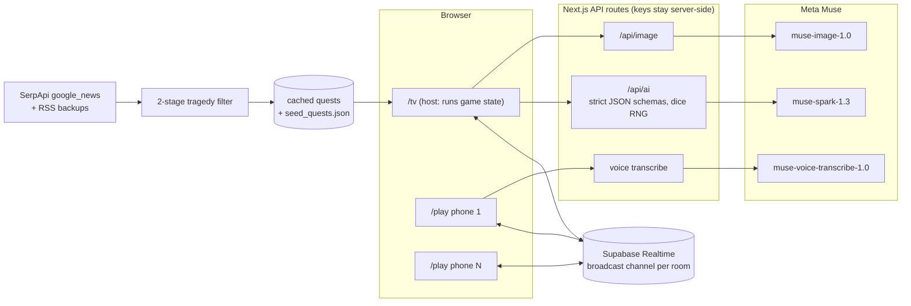

# Once Upon a Roll

**Nobody has to be the Dungeon Master anymore.** A co-op fairytale D&D night where an AI runs the table and every quest is today's real news, told as a fairytale. Built for HackTX '26 ("Once Upon a Hack").

> Screenshot placeholder: `docs/screenshot-tv.png` (TV scene) and `docs/screenshot-phone.png` (phone controller)

## What it is

- A laptop or TV is the table (`/tv`). Phones are character sheets and controllers (`/play`). 2 to 6 players join with a QR code or room code.
- Each player types or speaks a one-line hero. Muse Spark builds the stat card and Muse Image paints the portrait.
- Each round: **Pitch, Verdict, Pick, Roll.** Everyone pitches, the AI stamps each pitch (Clever / Solid / Risky / Absurd / Miracle), the party votes, and the winner rolls a d20 rolled by the server, never the AI.
- **Catch!** spends a Heart to reroll a friend's failed roll. A natural 1 puts a hero **In Peril**, and the next round is a **Rescue Round** where the hero in peril picks their savior.
- Quests are real Google News headlines (SerpApi), filtered for tragedy, and retold as fairytales. The last page of the storybook is a newsprint reveal: "This tale was inspired by real events."
- Finished storybooks are saved to the party's bookshelf.

## Run locally

Requires Node 20+.

```bash
cd game
npm i
```

Create `../.env.local` (one level above `game/`) with:

```bash
MODEL_API_KEY=...                  # Meta Muse API key (api.meta.ai)
SERPAPI_KEY=...                    # SerpApi key (google_news)
NEXT_PUBLIC_SUPABASE_URL=...       # Supabase project URL
NEXT_PUBLIC_SUPABASE_ANON_KEY=...  # Supabase anon key (Realtime broadcast)
```

If `../.env.local` is not picked up by Next, copy it to `game/.env.local`.

```bash
npm run dev
```

Then open `http://localhost:3000/tv` on a laptop and `/play` on phones (phones need the deployed HTTPS URL or a tunnel for microphone access).

Other scripts: `npm run build`, `npm run start`, `npm run lint`.

## Architecture



Key design rules:
- **The AI never touches numbers.** The server rolls dice with `crypto` RNG. Code computes DC, totals, Hope and outcomes.
- **Strict JSON schemas** on every Muse Spark call.
- **No news API call on the critical path.** Quests are pre-generated and cached; seed quests are the last-resort fallback.
- **Fallbacks:** Muse, then Gemini, then canned text, so the TV is never idle for more than about 3 s.
- Never use `-contributor` models.

## Tech

Next.js 15, React 19, TypeScript, Tailwind 4, Supabase Realtime, Meta Muse (Spark, Image, Voice Transcribe), SerpApi, Zod, Web Audio API, Vercel.

## Credits

- Meta Muse models, SerpApi Google News, Supabase, Vercel.
- Fonts: Cinzel, Cinzel Decorative, EB Garamond, Alegreya Sans, Libre Caslon Text, Inter (Google Fonts).
- Sound effects are synthesized with the Web Audio API.
- Created by our creative director and our engineer (with Claude Code) at HackTX '26.

**All code in this repository was written during HackTX '26.**
